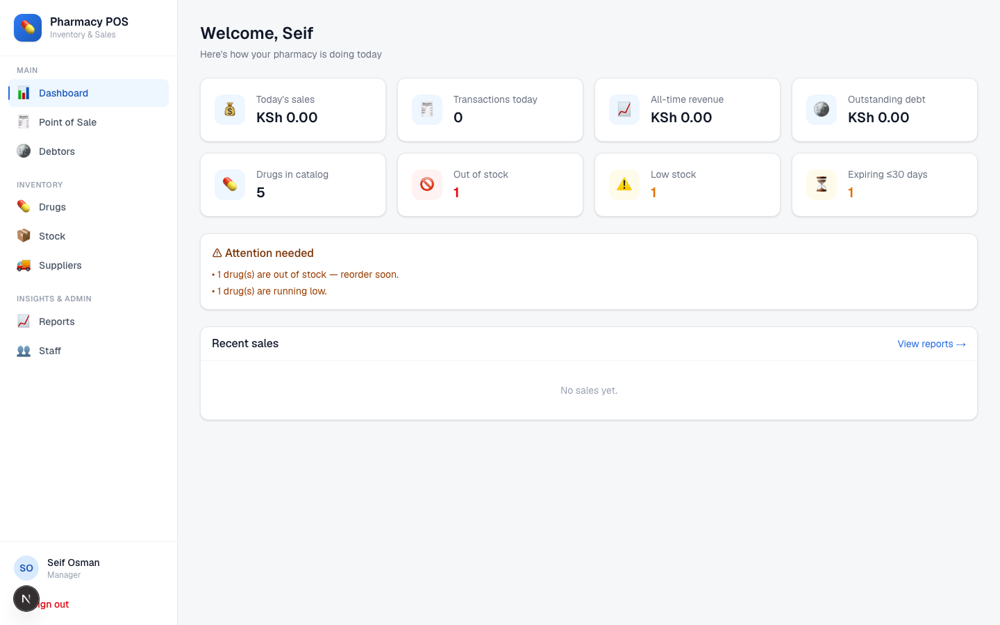
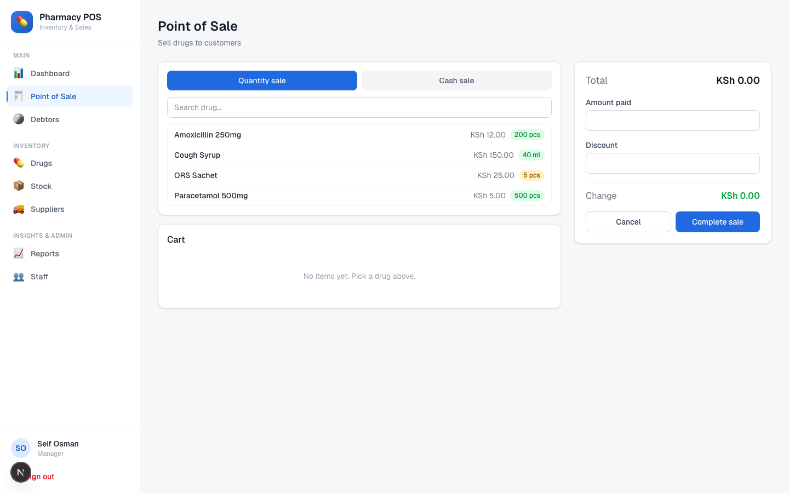
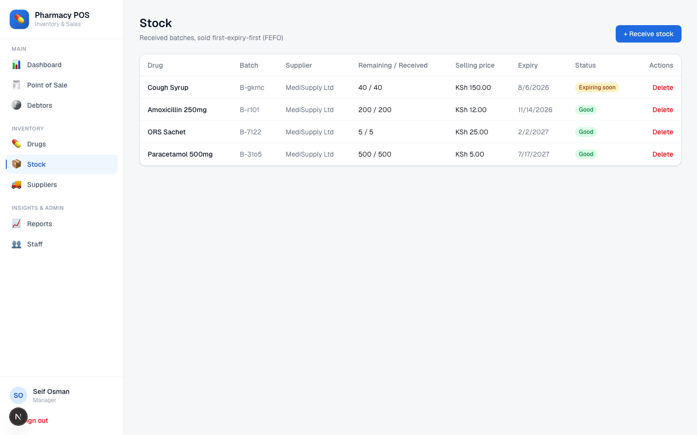

# Pharmacy POS

> A modern, secure web-based Pharmacy Point-of-Sale & Inventory Management System.

[](https://github.com/seifosmaan53/pharmacy-pos/actions/workflows/ci.yml)
[](./LICENSE)
[](https://nextjs.org)
[](https://react.dev)
[](https://typescriptlang.org)
[](https://prisma.io)
[](https://tailwindcss.com)
[](https://sqlite.org)

---

## Overview

**Pharmacy POS** is a full-stack point-of-sale and inventory platform for small and medium pharmacies. It handles selling (quantity & cash sales), drug and stock control with batch expiry, suppliers, credit customers (debtors), reporting, and staff roles — in one clean, fast web app you can run anywhere.

It is a ground-up rebuild of an older Windows-only C# WinForms pharmacy system, re-engineered to be cross-platform, secure by design, and pleasant to use — carrying over the original's domain knowledge of how a pharmacy counter actually operates (batch expiry, credit customers, shift-based staff roles) while fixing the data-modeling shortcuts that a decade-old WinForms app tends to accumulate.

Built by **Seif Osman**.

---

## Screenshots

| Dashboard | Point of Sale | Stock (FEFO batches) |
|---|---|---|
|  |  |  |

---

## Design decisions

This is a rebuild of an older Windows-only C# WinForms pharmacy app. The domain is faithful to the original (drugs, batches, suppliers, sales, debtors, staff), but the data model fixes three things that caused real bugs in a varchar-heavy WinForms/Access-era schema:

- **Money as integer cents, never floats.** Every price, total, and balance in `prisma/schema.prisma` is an `Int` counted in cents, converted at the edges by `lib/money.ts` (`toCents` / `fromCents` / `formatMoney`). This avoids the classic floating-point rounding drift that silently corrupts totals as sales accumulate.
- **Per-batch stock with FEFO, not a single running total.** Instead of one `net_stock` number per drug, each purchased batch is its own `Stock` row with quantity received, quantity remaining, and an expiry date. Selling draws from the batch expiring soonest first — First-Expiry-First-Out — implemented as a pure allocation function in `lib/fefo.ts` and used by `decrementStockFEFO` in `lib/inventory.ts` inside a Prisma transaction. For perishable medicine, selling from the wrong batch means stock that should have moved instead expires on the shelf.
- **Proper types instead of varchar-for-everything.** Dates are `DateTime`, quantities and prices are `Int`, roles are a Prisma `enum` — not strings parsed ad hoc at read time. This is what makes the FEFO ordering, low-stock/expiry alerts, and audit trail reliable instead of best-effort.

Two smaller decisions worth calling out:

- **Server-authoritative money and stock.** Server Actions (e.g. `app/(app)/pos/actions.ts`) re-validate every sale with Zod, re-derive totals from the database's own prices, and run the FEFO stock decrement plus the sale record in a single Prisma `$transaction` — the client's cart total is never trusted, and two concurrent sales can't oversell the same batch.
- **Signed, httpOnly, revocable sessions.** `lib/session.ts` signs a JWT (via `jose`) and refuses to start unless `SESSION_SECRET` is at least 32 characters, rather than silently signing with something short or guessable. A `tokenVersion` column on `User` lets logout or a password change invalidate all of that user's existing sessions server-side — something a bare stateless JWT can't do on its own.

---

## Tech Stack

| Technology | Version | Purpose |
|---|---|---|
| Next.js (App Router) | 16 | Framework + Server Actions |
| React | 19 | UI |
| TypeScript | 5 | Type safety |
| Tailwind CSS | 4 | Styling |
| Prisma | 6 | ORM + migrations |
| SQLite | — | Database (swappable to Postgres/MySQL) |
| jose | latest | JWT session cookies |
| bcryptjs | latest | Password hashing |
| Zod | latest | Input validation |
| pdf-lib | latest | PDF receipt generation |
| Vitest | 4 | Unit tests |

---

## Features

- **Point of Sale** — Quantity and cash sales, live cart, discounts, change calculation, and PDF/print receipts
- **Inventory** — Drugs, stock batches, and suppliers with full CRUD and live availability
- **Batch & Expiry Control** — Per-batch tracking, sold first-expiry-first-out (FEFO), with low-stock and expiry alerts
- **Debtors** — Credit sales, deposit/balance tracking, repayments, and auto-settlement
- **Dashboard** — Today's revenue, all-time totals, outstanding debt, and stock alerts at a glance
- **Reports** — Date-range sales, top-selling drugs, CSV export, and per-sale PDF receipts
- **Staff & Roles** — Manager and Pharmacist roles with role-based access
- **Audit Log** — Logins, sales, stock, debtor, and staff changes are recorded

---

## Security

- **Hashed passwords** (bcrypt) — never stored in plain text
- **Parameterized queries** via Prisma — no SQL injection
- **Signed, httpOnly JWT sessions** with server-side revocation (logout / password change invalidates tokens)
- **Role-based authorization** enforced inside every server action
- **Server-authoritative pricing & stock** — totals and inventory are never trusted from the client
- **Money stored as integer cents** — no floating-point rounding errors
- **Atomic sales** — stock decrement and sale records commit in a single transaction

---

## Getting Started

```bash
git clone https://github.com/seifosmaan53/pharmacy-pos.git
cd pharmacy-pos
npm install
cp .env.example .env       # then edit SESSION_SECRET before any real use
npx prisma migrate dev     # create the local SQLite database
npm run seed                # load demo data + default logins
npm run dev                 # http://localhost:3000
```

### Environment variables

`.env.example` documents every variable the app reads and its defaults are enough to run locally as-is:

| Variable | Used in | Purpose |
|---|---|---|
| `DATABASE_URL` | `prisma/schema.prisma` | SQLite connection string (default: local `dev.db` file) |
| `SESSION_SECRET` | `lib/session.ts` | Signs/verifies session JWTs. Must be ≥32 random characters — the app throws on startup otherwise |
| `NEXT_PUBLIC_CURRENCY` | `lib/money.ts` | Currency label shown in the UI and receipts (default `KSh`); cosmetic only — amounts are still stored as integer cents |

### Default logins

| Role | Staff number | Password |
|---|---|---|
| Manager | `1001` | `admin123` |
| Pharmacist | `2001` | `cashier123` |

> Change these and set a strong, unique `SESSION_SECRET` before any real use.

---

## Testing

The pure business logic — the code most worth protecting from regressions — has unit tests under `lib/__tests__/`, run with [Vitest](https://vitest.dev):

```bash
npm test
```

- **`lib/__tests__/money.test.ts`** — `toCents` / `fromCents` / `formatMoney`: string and number parsing, rounding to the nearest cent, rejecting negative/`NaN`/absurdly large amounts, and currency formatting.
- **`lib/__tests__/fefo.test.ts`** — `allocateFEFO` (the FEFO decision logic, factored out of `lib/inventory.ts` into `lib/fefo.ts` so it's testable without a database): picks the soonest-expiring batch first regardless of input order, spills into the next batch once one is exhausted, skips empty batches, throws `INSUFFICIENT_STOCK` when demand exceeds supply, and never mutates its input.

`scripts/test-sale.mjs` is a separate, pre-existing integration check — it runs a real sale against the seeded database (verifies stock decrements correctly, the sale record persists, and totals match), then rolls back its own mutation. Run it against a seeded dev database with `node scripts/test-sale.mjs`.

### Browser tests

`e2e/` holds a small [Playwright](https://playwright.dev) suite that drives the real UI in Chromium against a production build:

```bash
npm run build
npm run test:e2e
```

It never touches `dev.db`: `e2e/setup-db.ts` recreates a throwaway `prisma/e2e.db` from the migrations and seeds synthetic users and fictional products, and the file is deleted when the run ends (set `E2E_KEEP_DB=1` to keep it). It covers sign-in, sign-out, a FEFO sale on the POS, oversell attempts caught by the client and by the server, receiving and deleting stock, and a pharmacist being denied manager-only sections, including a direct call to the manager-only delete Server Action. Each mutating workflow is checked with a direct Prisma query, and the sale, server-side oversell, stock receipt and deletion are also checked after a fresh page load. CI runs it in the `e2e` job.

Debtors, drugs, suppliers, staff management and reports are not covered by browser tests yet.

---

## Roles

- **Manager** — Full access: staff, suppliers, deletions, plus everything a pharmacist can do
- **Pharmacist** — Point of sale, debtors, viewing drugs & stock, and reports

---

## Project Structure

```
app/
  login/            Sign-in (server action + bcrypt)
  (app)/            Authenticated area (guarded by layout)
    dashboard/  pos/  drugs/  stock/  suppliers/  debtors/  reports/  staff/
  api/receipt/      PDF receipt generation
lib/
  prisma · session · guards · inventory · fefo · money · dates · audit
  __tests__/        Vitest unit tests (money, fefo)
e2e/                Playwright browser tests + throwaway DB setup
prisma/
  schema.prisma · seed.ts · migrations/
scripts/
  test-sale.mjs     Integration check against a seeded DB
```

---

## Notes

- Money is stored everywhere as integer cents; convert with `lib/money.ts`
- Currency label is configurable via `NEXT_PUBLIC_CURRENCY` in `.env` (default `KSh`)
- Reset the database any time with `npm run db:reset`

---

## License

Released under the [MIT License](LICENSE).

---

Built by **Seif Osman**.
